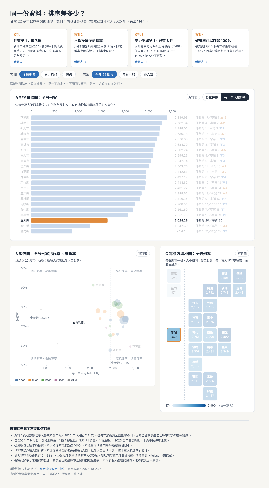

# 📝 期末專題說明：同一份資料，排序差多少？

- **課程名稱**：資料分析與視覺化應用
- **組員**：415085047 嚴庭亞、415085011 張凱富、410262690 陳予璇
- **GitHub Repository**：https://github.com/powerkaifu/taiwan-crime-rate-vis
- **作業網址**：https://powerkaifu.github.io/taiwan-crime-rate-vis/
- **影片網址**：〔待補〕
- **資料來源**：[內政部警政署《警政統計年報》2025 年（民國 114 年）](https://www.npa.gov.tw/ch/app/data/view?module=wg056&id=2217&serno=fbf5a752-9c50-4eb1-a3ac-8d4f7112c70a)
- **重製對象**：林宗弘〈[六都治理績效比一比](https://www.thinkingtaiwan.net/article/100493)〉，想想論壇，2026-10-23

## 📸 專案執行成果展示

<a href="./docs/網站製作文件/screenshots/step8-完整頁面.png" target="_blank" rel="noopener noreferrer">
  
</a>

各步驟截圖見 [`docs/網站製作文件/screenshots/`](./docs/網站製作文件/screenshots/)。

## 🔁 重製：原報導的問題與我們的做法

原文以表格圖片比較六都 2023-2025 年的刑案發生率（表 2）。

| 原報導的問題                                                                         | Munzner 層級 | 我們的做法                                                                                           |
| :----------------------------------------------------------------------------------- | :----------: | :--------------------------------------------------------------------------------------------------- |
| 只有數字表格，要逐格讀；高雄 1,660.14 與臺中 1,664.70 只差 0.3%，卻分屬第 1、第 3 名 |     編碼     | 圖表 A 用長度呈現數值，名次另以文字標示；名次只差 2 名以內時以淡色顯示                               |
| 只比六都，犯罪率全台最高的花蓮不在範圍內                                             |     領域     | 22 縣市全列，可篩選「只看六都」                                                                      |
| 三年平均與年增減率跨過 2024 年 9 月統計改制                                          |     抽象     | 只用 2025 單一年度（全年皆為新制）                                                                   |
| 只看件數或名次容易誤判                                                               |     抽象     | 圖表 A 件數 ⇄ 犯罪率切換，以「~~件數名次~~ → 換算後名次」顯示名次被更正；圖表 C 同時看犯罪率與破獲率 |
| 一般地圖會放大面積大的縣市                                                           |     編碼     | 圖表 B 等積方塊地圖，每個縣市一格                                                                    |
| 小縣市數字不穩                                                                       |     抽象     | 暴力犯罪率加 95% 信賴區間與件數標示                                                                  |

## 🛠️ 開發環境與技術棧

| 項目           | 版本／說明                                                            |
| :------------- | :-------------------------------------------------------------------- |
| 建置工具       | Vite 6.4                                                              |
| 核心框架       | Vue 3.5（Composition API／`<script setup>`）                          |
| 視覺化函式庫   | D3.js 7.9                                                             |
| 部署           | GitHub Actions → GitHub Pages（`vite.config.js` 的 `base` 為 `'./'`） |
| 視覺化理論架構 | Tamara Munzner《Visualization Analysis and Design》四層巢狀模型       |

---

## 📖 Tamara Munzner 四層巢狀模型分析（重點摘要）

### 🏛️ Level 1：領域情境（Domain Situation）

- **核心課題**：新聞與選舉攻防常以「件數」比較縣市治安；換成每十萬人犯罪率後，排序會差多少？
- **目標族群**：一般民眾（判斷自己縣市的相對位置）、查核記者（檢驗以件數排名的說法）。
- **資料範圍**：2025 年 22 縣市；全般刑案、暴力犯罪、竊盜三類；發生件數、每十萬人犯罪率、破獲率三項指標。

### 📊 Level 2：What / Why —— 資料與任務抽象化

#### What —— 資料屬性

- **資料集型態**：Table（22 縣市 × 多屬性）
- **類別屬性**：縣市、區域（北／中／南／東／離島）、是否六都
- **數量屬性**：發生件數、每十萬人犯罪率、破獲率（可超過 100%）
- **衍生屬性**：推估人口（件數 ÷ 犯罪率 × 10 萬）、件數名次、犯罪率名次、名次變動、暴力犯罪率 95% 信賴區間、中位數

#### Why —— 抽象任務 {Action, Target}

|   #    | 領域問題                               |  Action  |   Target    |
| :----: | :------------------------------------- | :------: | :---------: |
| Task 1 | 用件數排和用犯罪率排，縣市名次差多少？ | Compare  |    Ranks    |
| Task 2 | 哪些縣市特別高或特別低（如花蓮）？     | Identify |  Outliers   |
| Task 3 | 我住的縣市在全國的位置？               |  Lookup  |  Features   |
| Task 4 | 犯罪率高的縣市，破獲率也高嗎？         | Discover | Correlation |

### 🎨 Level 3：How —— 視覺編碼與互動設計

#### 1. 視覺編碼（Encode）

- **一個顏色一個意思**：率青＝每十萬人犯罪率、件數灰＝發生件數、螢光黃＝選取（懸停淡黃、鎖定實心黃）。
- **圖表 A 排名橫條圖**：長度＝件數（灰）或犯罪率（青）；切換時橫條長度補間、縣市以 Y 位置重新排序；犯罪率模式右側寫「~~件數名次~~ → 換算後名次」與 ▲▼ 名次變動，小幅變化以淡色顯示。
- **圖表 B 等積方塊地圖**：每縣市一格、率青單色明度色階＝犯罪率，格內字色依對比度自動選擇；0 件以灰色斜線、件數少於 30 以細斜線標示。
- **圖表 C 散佈圖**：X＝犯罪率、Y＝破獲率、面積＝推估人口，單一顏色；以 22 縣市中位數分成四區，四角以淺灰底標籤寫出區域名稱與縣市數（只描述位置、不貼價值標籤），兩軸加上「犯罪率越高 →」「↑ 破獲率越高」方向提示；固定標出六都與極端值；暴力犯罪加 100% 參考線。
- 每張圖的標題是由資料算出的一句結論，跟著案類與篩選改變。

#### 2. 多視圖協同（Coordinated Multiple Views）

- 三張圖共用同一份狀態：懸停或點選任一圖的縣市，三張圖同步標示，其他縣市變淡。
- 案類（全般／暴力／竊盜）與篩選套用到三張圖；「排序依據」只影響圖表 A。
- 版面：第一列 A＋B 並排（名次與地理同時看得到），第二列 C 全寬；控制列捲動時固定在頂端。

#### 3. 互動探索（Manipulate & Reduce）

- **發現卡**：4 張卡片一鍵切換到對應的案類、排序、篩選與縣市。
- **篩選**：全部／只看六都／非六都；不符合的縣市變淡但不隱藏，名次與中位數仍以全國計算。
- **Tooltip**：顯示犯罪率、件數、破獲率（含名次與中位數）與推估人口。
- **鎖定摘要**：點一下縣市鎖定後，控制列顯示該縣市的黃底摘要。
- **框選（Brush）**：在圖表 C 空白處拖曳框出一個範圍，框內縣市在三張圖同步標示（Brushing and Linking），控制列顯示「已框選 N 縣市」；按 Esc、按「清除框選」或在框外點一下取消。換案類或套用發現卡時自動清除。
- **資料表**：每張圖都可切換成表格。
- **鍵盤**：Tab 移到縣市、Enter 鎖定、Esc 取消；系統設定「減少動態效果」時不播放轉場。

### ⚙️ Level 4：演算法與工程實作

- **資料處理**：Vite `?raw` 直接打包 `data/csv/` 原始檔；`src/utils/crimeModel.js` 為純函式，網站與驗收腳本共用。
- **統計**：競賽排名（並列同名次）、中位數、Poisson 精確 95% 信賴區間（Garwood 法，二分搜尋求解）。
- **轉場**：D3 Object Constancy（以縣市為 key），750ms `easeCubicOut`。
- **驗收**：`npm run check` 以 28 項已知數字核對資料處理結果。

---

## 📌 主要互動功能與測試速查指南

| 區域   | 功能         | 操作方式                               | 預期反饋                                           |
| :----- | :----------- | :------------------------------------- | :------------------------------------------------- |
| 發現卡 | 一鍵切換情境 | 點「件數第 1 不等於犯罪率第 1」        | 切到全般刑案、犯罪率排序，三圖鎖定花蓮，捲到圖表 A |
| 發現卡 | 小數問題     | 點「暴力犯罪第 1，只有 8 件」          | 切到暴力犯罪，鎖定澎湖，顯示 95% 信賴區間          |
| 控制列 | 案類切換     | 點「全般刑案／暴力犯罪／竊盜」         | 三張圖以 750ms 轉場更新                            |
| 控制列 | 篩選         | 點「只看六都」                         | 三張圖只亮六都，其他變淡                           |
| 圖表 A | 排序切換     | 點圖 A 的「每十萬人犯罪率／發生件數」  | 橫條長度、顏色與順序動畫重排，▲▼ 顯示名次變動      |
| 任一圖 | 懸停         | 滑鼠移到縣市上                         | 出現 Tooltip，三圖同步標示該縣市                   |
| 任一圖 | 鎖定／取消   | 點一下縣市；再點一次、點空白處或按 Esc | 鎖定後三圖保持標示；取消後恢復                     |
| 圖表 C | 框選         | 在散佈圖空白處拖曳出一個框             | 框內縣市三圖同步標示，控制列顯示「已框選 N 縣市」  |
| 任一圖 | 資料表       | 點右上「資料表」                       | 圖表換成 22 列表格，再點「顯示圖表」切回           |

---

## 🧭 製作流程與執行方式

1. **資料**：從《警政統計年報》PDF 整理出 `data/csv/`；網站只讀 `各縣市刑案數據.csv` 與 `01_表1…全國歷年走勢.csv`（取 2025 年全國值）。
2. **規劃**：設計發想與規格見 `docs/網站製作文件/視覺化系統設計發想書_TamaraMunzner框架.md`、`docs/網站製作文件/實作規格書.md`。
3. **實作**：依規格書分 13 步完成（第 11～13 步為前端改版，見 `docs/網站製作文件/前端設計方向_更正單.md`），每步皆有截圖（`docs/網站製作文件/screenshots/`）與 git commit。
4. **檢查**：以 `npm run check` 核對 28 項已知數字，確認資料處理正確。

```bash
npm install      # 安裝套件
npm run dev      # 本機開發
npm run check    # 資料驗收（28 項）
npm run build    # 建置到 dist/
```

推送到 GitHub 的 `main` 分支後，`.github/workflows/deploy.yml` 會自動建置並部署到 GitHub Pages。

## ⚠️ 資料限制

- 自 2024 年 9 月起，部分刑案改以「1 被害人 1 發生數」計算；本專案只比較 2025 單一年度。
- 破獲數包含往年積案，破獲率可能超過 100%。
- 犯罪率採用官方公布的每十萬人犯罪率。
- 警察紀錄不含未報案的犯罪；數字是描述性差異，不代表個人風險或因果關係。

## 🚧 已知限制

- 圖上的縣市不能用鍵盤選取，鍵盤使用者可改用「資料表」；框選也只能用滑鼠操作。
- 只支援桌機（最小寬度 1280px）。
